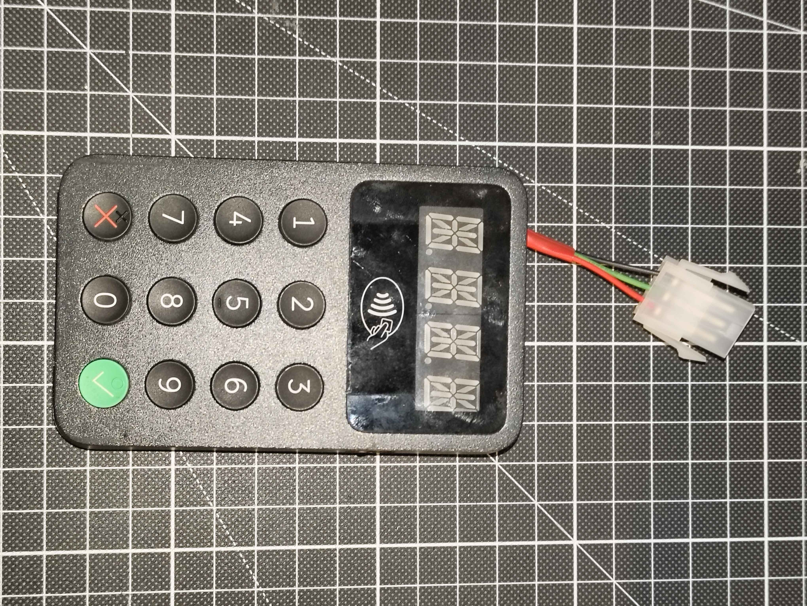
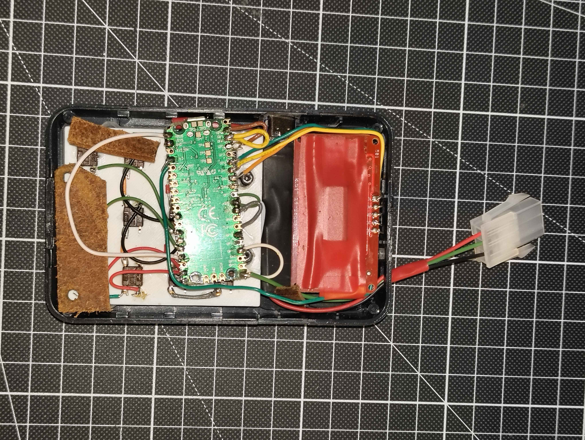

# iZettle-LED-terminal:
Got hold of an old iZettle payment terminal that I thought would look nice as a controller for my CASE LEDs :)

# Purpose:
- Power and controll my 12V WS2815 LED strip suspenders
- Fun project to spend some hours on 👀

# IMG

# Hardware:
- Old gutted iZettle payment terminal
- 14-segment LED HT16K33 display
- Raspberry Pi Pico
- 3x4 button layout, (wired direclty to gpio pins since i won't use all of them either way)
- Mini adjustable Buck (generic 12V->5V buck will do, important thing is small)
- Adjustable PD-trigger set to 12V. (Gutted this one aswell so i could get a lower profile)
- 12x Tactile switch 6 x 6 mm
- Small [3D printed plate/jig](CAD\) (Was meant as a test for fitment of tactile switches so does not have necessary holes to fit in the case)

# Libraries:
- Adafruit LED Backpack Library by Adafruit 1.5.1
- Adafruit GFX Library by Adafruit 1.13.0
- FastLED by Daniel Garcia 3.10.9

# Software:
- [betalterminalLEDS.ino](betalterminalLEDS/betalterminalLEDS.ino)
- FreeCAD

# Improvements if i were to do it again:

tbc
